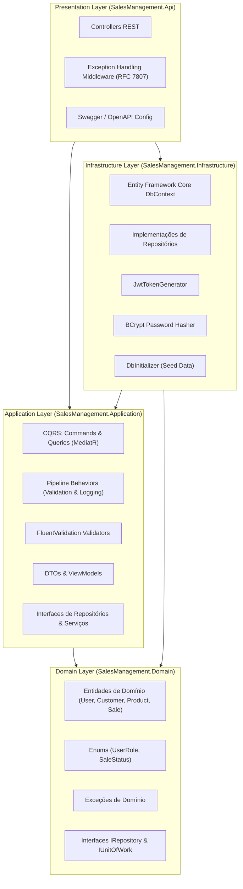
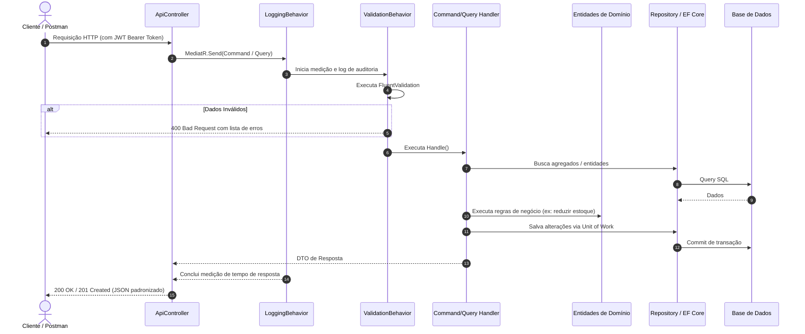

# 🏢 Sales & Customer Management API - Clean Architecture & CQRS

[](https://dotnet.microsoft.com/)
[](https://blog.cleancoder.com/uncle-bob/2012/08/13/the-clean-architecture.html)
[](https://github.com/jbogard/MediatR)
[](https://jwt.io/)
[](https://learn.microsoft.com/ef/core/)
[](https://fluentvalidation.net/)
[](https://www.docker.com/)

API REST corporativa e robusta de **Gestão de Clientes e Vendas (Sales & Customer Management)** desenvolvida com os mais altos padrões de engenharia de software da indústria: **Clean Architecture**, **CQRS (Command Query Responsibility Segregation)** com **MediatR**, autenticação e autorização via **JWT Bearer Tokens** com controle baseado em papéis (**Role-Based Access Control - Admin vs User**), validações automáticas com **FluentValidation**, persistência com **Entity Framework Core**, documentação interativa via **Swagger / OpenAPI** e empacotamento com **Docker**.

---

## 📐 1. Arquitetura do Sistema (Clean Architecture)

A solução está estruturada estritamente de acordo com os princípios da **Clean Architecture** (ou Onion Architecture), garantindo que as regras de negócio de domínio estejam no núcleo do sistema, totalmente desacopladas de frameworks, bibliotecas externas e detalhes de persistência.



### 🔄 Fluxo de Execução com CQRS e Pipeline Behaviors

Cada requisição passa por um pipeline de processamento automatizado antes de atingir as regras de negócio:



---

## ✨ 2. Principais Funcionalidades & Decisões Técnicas

| Componente | Detalhe da Implementação |
|---|---|
| **Arquitetura** | Clean Architecture dividida em 4 camadas (`Domain`, `Application`, `Infrastructure`, `Api`) + camada de testes automatizados (`UnitTests`). |
| **Padrão CQRS** | Separação completa de leituras (`Queries`) e mutações (`Commands`) utilizando **MediatR**. |
| **Pipeline Behaviors** | Interceptadores no pipeline do MediatR: `ValidationBehavior` (validação assíncrona automática) e `LoggingBehavior` (auditoria e medição de performance). |
| **Autenticação & Roles** | Tokens **JWT (JSON Web Token)** assinados com HMAC-SHA256, contendo Claims de identidade e papéis (`Admin` vs `User`). Proteção de endpoints via atributos `[Authorize]` e `[Authorize(Roles = "Admin")]`. |
| **Segurança de Senhas** | Hashing criptográfico unidirecional seguro utilizando **BCrypt**. |
| **Entity Framework Core 8** | Mapeamento com Fluent API, suporte nativo a múltiplos provedores: **SQLite** (zero-configuração para testes instantâneos), **PostgreSQL** e **SQL Server**. |
| **Tratamento Global de Erros** | Middleware centralizado gerando respostas compatíveis com o padrão **RFC 7807 Problem Details** (400 para validação, 401 para não autenticado, 403 para não autorizado, 404 para não encontrado, 422 para estoque insuficiente, 500 para falhas inesperadas). |
| **Seed Data Automático** | Base de dados populada na primeira inicialização com contas de Administrador, Vendedor, Clientes, Produtos do catálogo e Pedidos demonstrativos. |
| **Documentação Interativa** | **Swagger UI** configurado com suporte ao botão **Authorize (Bearer Token)** para testes completos no navegador. |

---

## 🔑 3. Credenciais Pré-configuradas (Seed Data)

Ao iniciar a aplicação pela primeira vez, os seguintes usuários estão disponíveis para testes imediatos:

| Papel (*Role*) | E-mail | Senha | Permissões |
|---|---|---|---|
| **Administrador** | `admin@salesmanagement.com` | `Admin@123` | Acesso total: Gestão de Clientes, Criação/Edição de Produtos, Atualização de Estoque, Cancelamento de Vendas. |
| **Usuário Padrão** | `user@salesmanagement.com` | `User@123` | Acesso operacional: Leitura de Clientes/Produtos, Criação de Vendas/Pedidos. |

---

## 🚀 4. Como Executar o Projeto

### Opção A: Execução Local com .NET CLI (Recomendado para Testes Rápidos)

> **Zero configuração necessária!** O projeto usa SQLite por padrão, criando a base e os dados de seed automaticamente.

1. **Restaurar e compilar a solução:**
   ```bash
   dotnet build
   ```

2. **Executar a API:**
   ```bash
   dotnet run --project src/SalesManagement.Api/SalesManagement.Api.csproj
   ```

3. **Aceder à Documentação Swagger:**
   Abra no seu navegador: **[http://localhost:5050](http://localhost:5050)** (ou a porta informada no terminal).

---

### Opção B: Execução com Docker e Docker Compose (Com PostgreSQL)

O repositório inclui um `Dockerfile` multi-stage otimizado e um `docker-compose.yml` que orquestra a API e uma instância dedicada do **PostgreSQL 16**.

1. **Subir os containers:**
   ```bash
   docker compose up --build
   ```

2. **Aceder à API no Docker:**
   - Swagger UI: **[http://localhost:5000](http://localhost:5000)**
   - Porta da base de dados PostgreSQL: `localhost:5432`

3. **Encerrar os containers:**
   ```bash
   docker compose down -v
   ```

---

## 🧪 5. Testes Automatizados

O projeto inclui uma suite de testes unitários com **xUnit**, **FluentAssertions** e **Moq**, cobrindo regras de negócio de domínio (como redução e restauração de estoque), handlers de comandos de autenticação e validações de criação de clientes.

Para rodar todos os testes:
```bash
dotnet test
```

---

## 📮 6. Testando com Postman ou Bruno

Para facilitar a validação e demonstração aos clientes, incluímos coleções completas pré-configuradas:

### 1. Coleção do Postman
- Ficheiro da coleção: [`postman/SalesManagement.postman_collection.json`](file:///c:/Users/pedro/Desktop/ProjetosPessoais/SalesManagementApi/postman/SalesManagement.postman_collection.json)
- Ficheiro do ambiente: [`postman/SalesManagement.postman_environment.json`](file:///c:/Users/pedro/Desktop/ProjetosPessoais/SalesManagementApi/postman/SalesManagement.postman_environment.json)

**Como usar:**
1. No Postman, clique em **Import** e selecione ambos os ficheiros da pasta `postman/`.
2. Selecione o ambiente `Sales Management API - Local`.
3. Execute a requisição `01. Authentication -> Login as Admin`. O token JWT é extraído e injetado automaticamente na variável `{{jwt_token}}` para todas as requisições subsequentes!

### 2. Coleção do Bruno
- Pasta da coleção: [`bruno/`](file:///c:/Users/pedro/Desktop/ProjetosPessoais/SalesManagementApi/bruno/)

**Como usar:**
1. No [Bruno](https://www.usebruno.com/), clique em **Open Collection** e escolha a pasta `bruno/`.
2. Selecione o ambiente `Local`.
3. Execute `01-Auth -> Login Admin` para salvar o token e executar os demais endpoints.

---

## 📚 7. Tabela de Endpoints da API

### Autenticação (`/api/auth`)
| Método | Endpoint | Autenticação | Permissão | Descrição |
|---|---|---|---|---|
| `POST` | `/api/auth/register` | Anônimo | Pública | Registra novo usuário no sistema |
| `POST` | `/api/auth/login` | Anônimo | Pública | Autentica e retorna token JWT |
| `GET` | `/api/auth/me` | Bearer Token | Qualquer | Retorna perfil do usuário logado |

### Clientes (`/api/customers`)
| Método | Endpoint | Autenticação | Permissão | Descrição |
|---|---|---|---|---|
| `GET` | `/api/customers` | Bearer Token | Qualquer | Lista clientes paginados com filtro de busca |
| `GET` | `/api/customers/{id}` | Bearer Token | Qualquer | Obtém detalhes de um cliente por ID |
| `POST` | `/api/customers` | Bearer Token | Qualquer | Cadastra um novo cliente |
| `PUT` | `/api/customers/{id}` | Bearer Token | Qualquer | Atualiza dados de um cliente |
| `DELETE` | `/api/customers/{id}` | Bearer Token | **Admin** | Desativa/remove um cliente |

### Produtos (`/api/products`)
| Método | Endpoint | Autenticação | Permissão | Descrição |
|---|---|---|---|---|
| `GET` | `/api/products` | Bearer Token | Qualquer | Lista produtos paginados do catálogo |
| `GET` | `/api/products/{id}` | Bearer Token | Qualquer | Obtém detalhes do produto por ID |
| `POST` | `/api/products` | Bearer Token | **Admin** | Cria novo produto no catálogo |
| `PUT` | `/api/products/{id}` | Bearer Token | **Admin** | Atualiza informações do produto |
| `PATCH` | `/api/products/{id}/stock`| Bearer Token | **Admin** | Ajusta quantidade em estoque |
| `DELETE` | `/api/products/{id}` | Bearer Token | **Admin** | Desativa um produto do catálogo |

### Vendas & Pedidos (`/api/sales`)
| Método | Endpoint | Autenticação | Permissão | Descrição |
|---|---|---|---|---|
| `GET` | `/api/sales` | Bearer Token | Qualquer | Lista vendas paginadas (com filtros) |
| `GET` | `/api/sales/{id}` | Bearer Token | Qualquer | Obtém detalhes da venda e itens |
| `POST` | `/api/sales` | Bearer Token | Qualquer | Realiza venda e abate estoque automaticamente |
| `POST` | `/api/sales/{id}/cancel` | Bearer Token | **Admin** | Cancela venda e devolve itens ao estoque |

---

## 📁 8. Estrutura de Pastas do Repositório

```text
SalesManagementApi/
├── .gitignore
├── Dockerfile
├── docker-compose.yml
├── README.md
├── SalesManagementApi.sln
├── postman/
│   ├── SalesManagement.postman_collection.json
│   └── SalesManagement.postman_environment.json
├── bruno/
│   ├── bruno.json
│   ├── environments/
│   ├── 01-Auth/
│   ├── 02-Customers/
│   ├── 03-Products/
│   └── 04-Sales/
├── src/
│   ├── SalesManagement.Domain/           # Entidades, Enums, Exceções de Negócio, Interfaces de Repositório
│   ├── SalesManagement.Application/      # CQRS (MediatR), FluentValidation, Pipeline Behaviors, DTOs
│   ├── SalesManagement.Infrastructure/   # EF Core DbContext, Repositórios, JWT Generator, BCrypt, Seed
│   └── SalesManagement.Api/              # Controllers, Program.cs, Middlewares (RFC 7807), Swagger
└── tests/
    └── SalesManagement.UnitTests/        # Testes de Domínio e Handlers com xUnit, Moq e FluentAssertions
```

---

## 👨‍💻 Desenvolvido com Boas Práticas Corporativas
- **SOLID & Clean Code**: Alta coesão, baixo acoplamento e separação estrita de responsabilidades.
- **Domain-Driven Design (DDD) Lite**: Entidades ricas com encapsulamento de regras de negócio.
- **Fail-Fast com FluentValidation**: Validações de requisições acontecem antes do handler de negócio.
- **Segurança Pronta para Produção**: Claims, JWTs com assinatura segura e senhas com BCrypt.
